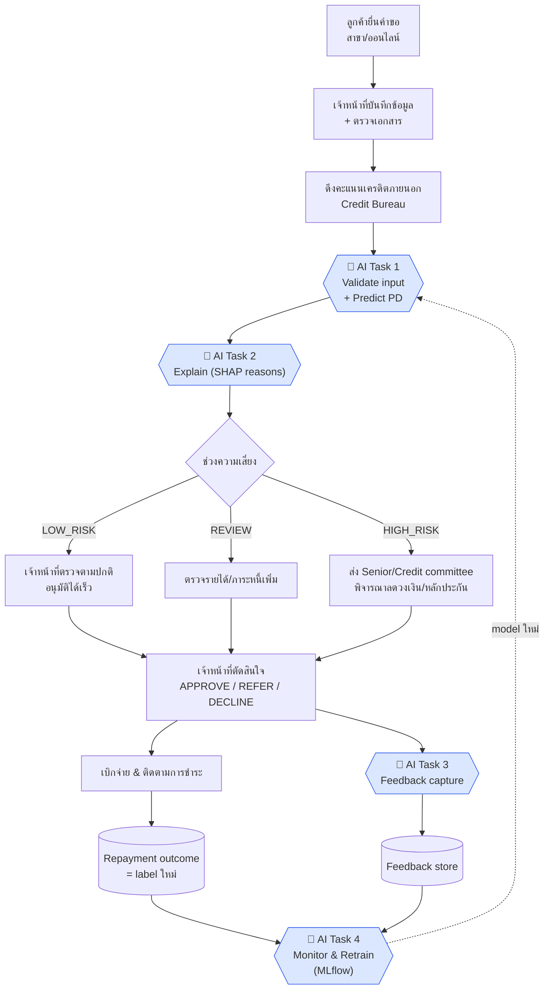
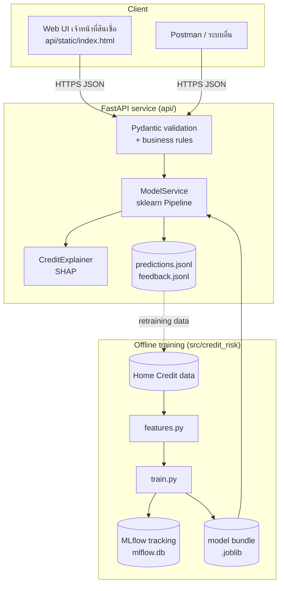
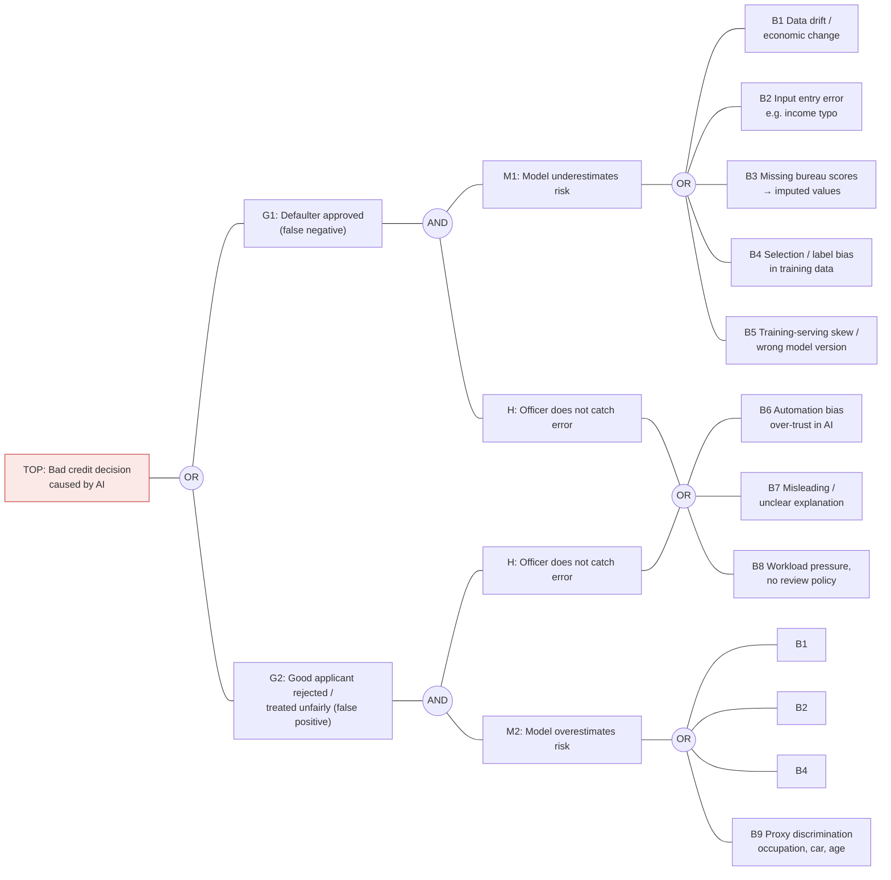
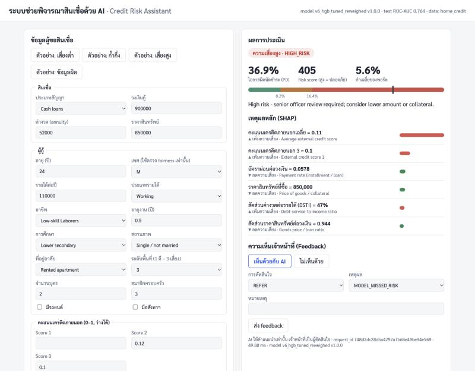

# Section 2 — System Design

## 2.1 System Objectives

### 2.1.1 Goals

| ระดับ | เป้าหมาย | Leading indicator / เป้าตัวเลข |
|---|---|---|
| **Organization** | ลดสัดส่วนหนี้เสียของสินเชื่อใหม่ และเพิ่มรายได้จากการอนุมัติลูกค้าดีได้เร็วขึ้น | **Leading:** อัตรา *First Payment Default* และ 30+ DPD ภายใน 3 เดือน (เห็นผลก่อน NPL 12 เดือน) ลดลง 15%, สัดส่วนคำขอที่ตัดสินใจได้ภายใน 1 วัน ≥ 70% |
| **System** | ให้คะแนนความเสี่ยงพร้อมเหตุผลแบบ real-time และเสถียร | p95 latency < 300 ms, availability ≥ 99.5%, ทุก prediction ถูก log พร้อม model version (100%) |
| **User** (เจ้าหน้าที่สินเชื่อ) | ตัดสินใจเร็วขึ้นและมั่นใจขึ้น โดยเข้าใจเหตุผลของ AI | เวลาพิจารณาต่อคำขอลดจาก ~45 เป็น ≤ 20 นาที, คะแนนความเข้าใจคำอธิบาย ≥ 4/5, อัตราส่ง feedback ≥ 30% |
| **User** (ผู้กู้) | ได้รับการพิจารณาที่เป็นธรรมและได้เหตุผลเมื่อถูกปฏิเสธ | ทุกกรณี HIGH_RISK มี reason codes, Disparate Impact ratio ≥ 0.8 |
| **Model** | แยกผู้กู้ดีและไม่ดีได้ ให้ PD ที่ calibrated และเป็นธรรม | ROC-AUC ≥ 0.75, KS ≥ 0.35, Brier ≤ baseline, gender FPR gap ≤ 0.05 |

### 2.1.2 Measurement and Data

| Goal | Measurement | Data collection | Operationalization |
|---|---|---|---|
| Org: ลดหนี้เสีย | FPD / 30+ DPD rate ของ cohort ที่อนุมัติหลังใช้ระบบ เทียบ cohort ก่อนใช้ (หรือ A/B ตามสาขา) | ระบบบริหารหนี้ (collections) ส่งสถานะการชำระรายเดือน แล้ว join ด้วย `application_id` | Dashboard รายเดือน; ถ้าลดลงไม่ถึง 10% ใน 6 เดือน ให้ทบทวน threshold/โมเดล |
| Org: ความเร็ว | ระยะเวลาจากยื่นคำขอถึงตัดสินใจ (median, p90) | timestamp ใน Loan Origination System + `timestamp` ใน prediction log | KPI สาขา: ≥ 70% ตัดสินใจภายใน 1 วัน |
| System | latency p50/p95, error rate 5xx, uptime | header `X-Process-Time-ms`, access log, health check `/health` ทุก 30 วินาที | แจ้งเตือนเมื่อ p95 > 300 ms หรือ 5xx > 1% ใน 5 นาที |
| User: เวลาและความมั่นใจ | เวลาต่อคำขอ, survey 5-point, feedback rate | UI event log (เปิดหน้า → ส่ง feedback), แบบสอบถามรายไตรมาส, `/v1/feedback` | สัดส่วน feedback ต่อ prediction, % ที่ `agrees_with_model` |
| User: ความเป็นธรรม | Disparate impact, FPR gap ตามเพศ/ช่วงอายุ | `gender` เก็บแยกใน prediction log (ไม่ส่งเข้าโมเดล), age group จากข้อมูลคำขอ | รายงาน fairness รายเดือน; DI < 0.8 → investigate |
| Model | ROC-AUC, PR-AUC, KS, Brier บน holdout + ข้อมูลใหม่ที่ได้ label แล้ว | Train/val/test split ตอนพัฒนา; production ใช้ label จาก collections (ล่าช้า 3–12 เดือน) | Retrain เมื่อ AUC ลดลง > 0.03 หรือ PSI ของ feature หลัก > 0.25 |

## 2.2 AI Component Design

### 2.2.1 Business Workflow & AI Tasks

**System architecture**

### 2.2.2 AI Task Requirements (REQ / SPEC / ENV)

*REQ คือสิ่งที่ต้องการให้เกิดในโลกจริง ENV คือสมมติฐานเกี่ยวกับสภาพแวดล้อม SPEC คือพฤติกรรมของ software โดยต้องเป็นจริงว่า ENV ∧ SPEC ⊨ REQ*

| ID | Requirement (REQ, โลกจริง) |
|---|---|
| REQ-1 | สินเชื่อที่อนุมัติผ่านระบบต้องมีอัตราผิดนัดต่ำกว่าก่อนใช้ระบบ |
| REQ-2 | ผู้กู้ต้องไม่ถูกปฏิบัติแตกต่างเพราะเพศหรืออายุ โดยไม่มีเหตุผลด้านความเสี่ยงที่ชอบธรรม |
| REQ-3 | ผู้กู้ที่ถูกปฏิเสธหรือถูกเพ่งเล็งต้องได้รับเหตุผลที่เข้าใจได้ |
| REQ-4 | การตัดสินใจขั้นสุดท้ายเป็นของมนุษย์ (accountability) |

| ID | Specification (SPEC, ระบบ) |
|---|---|
| SPEC-1 | `/v1/predict` คืนค่า PD ∈ [0,1], risk score, decision band ภายใน 300 ms (p95) |
| SPEC-2 | โมเดลมี ROC-AUC ≥ 0.75 และ Brier ≤ baseline บน holdout test set |
| SPEC-3 | ถ้า PD ≥ threshold (เลือกจาก cost 5:1) → HIGH_RISK, ถ้า PD ≥ 0.5×threshold → REVIEW |
| SPEC-4 | `gender` ไม่ถูกใช้เป็น feature (ตรวจได้จาก `/v1/model` และ test S4) |
| SPEC-5 | ทุก prediction คืน top-k เหตุผลจาก SHAP พร้อมทิศทาง (เพิ่ม/ลดความเสี่ยง) |
| SPEC-6 | Input ผิด schema → 422, ข้อมูลขัดแย้ง → 400, โมเดลไม่พร้อม → 503 พร้อม error code |
| SPEC-7 | ค่าที่อยู่นอกช่วง 1–99 percentile ของข้อมูล train ต้องมี `warnings` |
| SPEC-8 | UI ไม่มีปุ่ม “อนุมัติอัตโนมัติ” เจ้าหน้าที่ต้องเลือก decision เอง |

| ID | Environmental assumption (ENV) |
|---|---|
| ENV-1 | ข้อมูลที่เจ้าหน้าที่กรอกตรงกับเอกสารจริง (รายได้ผ่านการตรวจสอบแล้ว) |
| ENV-2 | ผู้กู้ในอนาคตมีลักษณะใกล้เคียงข้อมูลในอดีต (ไม่มี distribution shift รุนแรง) |
| ENV-3 | คะแนน credit bureau มีให้ใช้สำหรับผู้กู้ส่วนใหญ่ |
| ENV-4 | เจ้าหน้าที่อ่านเหตุผลและพิจารณากรณี REVIEW/HIGH_RISK จริง ไม่กดตามอย่างเดียว |
| ENV-5 | Label (ผิดนัด/ไม่ผิดนัด) ในข้อมูลอดีตถูกต้อง และมีเฉพาะคนที่เคยได้รับอนุมัติ (selection bias รับรู้ไว้แล้ว) |

### 2.2.3 ML Canvas

| ช่อง | AI Task 1–2: Default risk prediction + explanation |
|---|---|
| **Value proposition** | เจ้าหน้าที่ได้คะแนนความเสี่ยงและเหตุผลทันที ตัดสินใจเร็วและสม่ำเสมอขึ้น ส่วนธนาคารลดหนี้เสีย |
| **Prediction task** | Binary classification: ผู้กู้จะมีปัญหาการชำระหรือไม่ (`TARGET`=1) โดย output คือ PD (probability) |
| **Decisions** | แปลง PD เป็น 3 ช่วง (LOW/REVIEW/HIGH) ด้วย threshold ที่ลด expected cost (FN:FP = 5:1) เพื่อกำหนด workflow การตรวจ |
| **Impact simulation** | ก่อน deploy วัด expected cost, recall, flag rate และ default rate ในแต่ละ band บน test set (ดู `reports/results.md`) |
| **Making predictions** | Real-time ผ่าน REST API ต่อ 1 คำขอ (~10 ms) และ batch endpoint สำหรับ re-score พอร์ต |
| **Data collection** | Label มาจากผลการชำระจริง 3–12 เดือนหลังเบิกจ่าย และ feedback ของเจ้าหน้าที่จาก UI |
| **Data sources** | Home Credit `application_train.csv` (307,511 แถว) ประกอบด้วยข้อมูลคำขอ ประชากรศาสตร์ และ EXT_SOURCE (credit bureau) |
| **Input data** | 21 ฟิลด์ดิบ ได้แก่ categorical 6 ตัว, numeric 14 ตัว และ gender (สำหรับ audit เท่านั้น) มี missing สูงใน EXT_SOURCE_1 และ OCCUPATION และมีค่า sentinel 365243 |
| **Features** | ฟิลด์ดิบ + 8 domain ratios (DSTI, loan-to-income, payment rate, goods/credit, employed/age, ext_source mean/missing) + missing indicators + one-hot |
| **Building models** | sklearn Pipeline เปรียบเทียบ 6 versions (LogReg, RF, HistGB, tuned, reweighed) ใน MLflow แล้วเลือกด้วย calibration gate → AUC → fairness → latency |
| **Expected outputs** | JSON: `probability_of_default`, `risk_score` (0–1000), `decision_band`, `reasons[]` (feature, value, SHAP, direction, text), `warnings[]` |
| **Success criteria** | ROC-AUC ≥ 0.75, KS ≥ 0.35, calibrated (Brier ≤ baseline), DI ≥ 0.8, p95 latency < 300 ms |
| **Live monitoring** | PSI ของ feature หลัก, distribution ของ PD/band, agreement rate จาก feedback, AUC บน label ใหม่ และ fairness รายเดือน |

> สำหรับ **AI Task 4 (Monitor & Retrain)** canvas ใช้โครงเดียวกัน โดย input คือ prediction log + feedback + outcomes และ output คือการตัดสินใจว่าจะ retrain หรือไม่

### 2.2.4 Risk Analysis — Fault Tree Analysis

**Top event:** *การตัดสินใจสินเชื่อผิดพลาดอันมีสาเหตุจาก AI component* (ขาดทุนจากหนี้เสีย หรือปฏิเสธลูกค้าดีอย่างไม่เป็นธรรม)

**Minimum Cut Sets (MCS)**

ทั้งสองกิ่งเป็น AND ของ “โมเดลผิด” กับ “มนุษย์ไม่จับ” จึง **ไม่มี single-point failure** ทุก MCS มีขนาด 2 ตามที่ออกแบบให้มี human-in-the-loop

* G1: {B1,B6}, {B1,B7}, {B1,B8}, {B2,B6}, {B2,B7}, {B2,B8}, {B3,B6}, {B3,B7}, {B3,B8}, {B4,B6}, {B4,B7}, {B4,B8}, {B5,B6}, {B5,B7}, {B5,B8}
* G2: {B9,B6}, {B9,B7}, {B9,B8} (คู่ของ B1/B2/B4 กับ B6–B8 ซ้ำกับ G1)

รวม **18 MCS ที่ไม่ซ้ำกัน** ข้อสังเกตสำคัญ:
1. **B6 (automation bias)** อยู่ใน 6 MCS เท่ากับ B7 และ B8 ฝั่งมนุษย์จึงเป็นจุดอ่อนร่วมที่สำคัญที่สุด ถ้าเจ้าหน้าที่เชื่อ AI โดยไม่ตรวจ ระบบจะเหลือการป้องกันชั้นเดียว
2. ฝั่งโมเดล **B1 (drift)** และ **B2 (input error)** ทำให้ผิดได้ทั้งสองทิศ จึงควรลงทุนป้องกันก่อน

### 2.2.5 Risk Mitigation

| Basic event | Mitigation (มีใน PoC ✅ / แผน production 🔜) |
|---|---|
| B1 Drift | ✅ `training_profile` + `warnings` สำหรับค่านอกช่วง · 🔜 PSI รายสัปดาห์จาก `predictions.jsonl` และ retrain trigger |
| B2 Input error | ✅ Pydantic schema (ช่วงค่า, enum) → 422 · ✅ business rules (ค่างวด > วงเงิน, อายุงาน > อายุ) → 400 · ✅ เตือนค่าผิดปกติ |
| B3 Missing scores | ✅ missing indicators + `ext_source_missing` ให้โมเดลรู้ว่าข้อมูลหาย · 🔜 แสดง “ความมั่นใจต่ำ” เมื่อ bureau หายครบ 3 ตัว |
| B4 Selection bias | ✅ บันทึกไว้ใน ENV-5 · 🔜 reject inference / เก็บ outcome ของกลุ่ม REFER ที่อนุมัติแบบมีเงื่อนไข |
| B5 Skew / version | ✅ preprocessing อยู่ใน sklearn Pipeline เดียวกับโมเดล · ✅ model version และ MLflow run id อยู่ทุก response · ✅ unit tests |
| B9 Proxy bias | ✅ ไม่ใช้ gender เป็น feature · ✅ fairness audit (DI, FPR gap, EO) ทุก version · ✅ v6 reweighing · ✅ calibration/fairness ใช้ในการเลือกโมเดล |
| B6 Automation bias | ✅ UI แสดงเป็น “คำแนะนำ” ไม่มีปุ่มอนุมัติอัตโนมัติ · ✅ ต้องเลือก decision และเหตุผลเอง · 🔜 สุ่ม audit กรณี LOW_RISK |
| B7 Explanation | ✅ เหตุผลรวม one-hot กลับเป็นฟิลด์เดิม เป็นภาษาไทย พร้อมค่าจริงและทิศทาง · ✅ ทดสอบว่า SHAP รวมแล้วเท่ากับ prediction |
| B8 Workload | ✅ แบ่ง 3 band ให้เจ้าหน้าที่โฟกัสเฉพาะเคส REVIEW/HIGH · 🔜 SLA และ review policy |

## 2.3 User Interaction Design (Intelligent Experiences)

### 2.3.1 User Experience Design

**Sample UI:** หน้าจอเจ้าหน้าที่สินเชื่อ (`api/static/index.html`, รันจริงที่ `http://localhost:8000/`)

องค์ประกอบของหน้าจอผลการประเมิน:
1. **Decision band** สีเขียว/ส้ม/แดง พร้อมคำแนะนำว่าควรทำอะไรต่อ
2. **PD, Risk score (0–1000) และค่าเฉลี่ยของพอร์ต** ให้เทียบได้ว่าผู้กู้รายนี้เสี่ยงกว่าค่าเฉลี่ยเท่าไร
3. **แถบ threshold** แสดงตำแหน่งของผู้กู้เทียบกับเส้นแบ่ง REVIEW/HIGH_RISK
4. **เหตุผลหลัก (SHAP)** ▲/▼ พร้อมค่าจริง และความยาวแถบตามน้ำหนัก
5. **Feedback** เห็นด้วย/ไม่เห็นด้วย + decision + reason code
6. ข้อความ “AI ให้คำแนะนำเท่านั้น” + request_id และ model version สำหรับ audit

**User Feedback:**
* *Explicit:* ปุ่ม “เห็นด้วย / ไม่เห็นด้วย” + decision ของเจ้าหน้าที่ + reason code (เช่น `COLLATERAL_STRONG`, `MODEL_MISSED_RISK`) + หมายเหตุ ส่งไป `POST /v1/feedback`
* *Implicit:* ความต่างระหว่าง decision band กับ `officer_decision` (override rate)
* *Outcome:* `actual_outcome` (REPAID/DEFAULTED) จากฝ่ายติดตามหนี้ ใช้เป็น label ใหม่สำหรับ retrain
* ใช้ feedback วิเคราะห์จุดที่โมเดลพลาดบ่อย เช่น reason `MODEL_MISSED_RISK` ใน LOW_RISK

**Presenting Intelligence: Prompt + Annotate (ไม่ Automate)**

| โหมด | ใช้หรือไม่ | เหตุผล |
|---|---|---|
| Automate | ❌ | การปฏิเสธสินเชื่อกระทบชีวิตผู้กู้และมีข้อกำกับดูแล (accountability, PDPA, หลักการ fair lending) ความผิดพลาดมีต้นทุนสูง และโมเดล AUC ~0.75 ยังผิดได้บ่อย |
| Prompt | ✅ สำหรับ HIGH_RISK/REVIEW | แสดง band สีเด่นและคำแนะนำ (“ส่ง senior review”, “ตรวจรายได้”) ให้เจ้าหน้าที่ต้องตอบสนอง |
| Annotate | ✅ ทุกเคส | แสดง PD, risk score และเหตุผล SHAP ข้างข้อมูลคำขอ โดยไม่บังคับ |

ความ assertive จึงอยู่ระดับ **ปานกลาง** เพราะผลกระทบของความผิดพลาดสูง ความแม่นยำปานกลาง และผู้ใช้เป็นผู้เชี่ยวชาญที่ต้องรับผิดชอบการตัดสินใจ

### 2.3.2 AI Model Deployment

**เลือก: Cloud / Server-side (private cloud หรือ data center ของธนาคาร) ในรูป container ของ FastAPI**

| ตัวเลือก | ประเมิน |
|---|---|
| **Cloud / Server** ✅ | ข้อมูลสินเชื่อเป็นข้อมูลส่วนบุคคลอ่อนไหว (PDPA) ต้องอยู่ในระบบที่ควบคุมได้ อัปเดตโมเดลได้ที่จุดเดียว log และ audit ได้ครบ ทุกสาขาใช้โมเดลเวอร์ชันเดียวกัน โมเดลเล็ก (~1.5 MB) และเร็ว (~40 ms ต่อ request รวม SHAP) จึงไม่ต้องใช้ GPU |
| Edge (เครื่องสาขา) ❌ | ต้อง sync โมเดลหลายเครื่อง เสี่ยงใช้คนละเวอร์ชัน (B5) และ log ไม่รวมศูนย์ |
| Embedded / mobile ❌ | โมเดลอาจถูก reverse-engineer เพื่อ “เล่นระบบ” และข้อมูล bureau ต้องดึงจาก server อยู่แล้ว |

### 2.3.3 Performance Factors (นอกเหนือ accuracy)

| ปัจจัย | ค่าที่วัดได้ (ดู `reports/results.md`) | ทำไมสำคัญ |
|---|---|---|
| **Prediction latency** | LogReg ~2 ms, HistGB 9–32 ms, RF ~26 ms ต่อคำขอ ทั้ง API request รวม SHAP ~40 ms | เจ้าหน้าที่ต้องเห็นผลทันทีระหว่างคุยกับลูกค้า |
| **Model size** | LogReg 0.01 MB, HistGB 0.4–1.5 MB, RF 37 MB | โหลดเร็ว, scale แนวนอนง่าย, ค่าใช้จ่ายต่ำ |
| **Calibration (Brier)** | ใช้เป็น gate ในการเลือกโมเดล | UI แสดง PD เป็น % จึงต้องเชื่อถือได้ (class weighting ทำให้ PD สูงเกินจริง) |
| **Interpretability** | SHAP exact สำหรับ linear/tree | ข้อกำกับดูแลกำหนดให้อธิบายเหตุผลได้ |
| **Fairness** | DI, FPR gap ต่อ version | เป็นเกณฑ์ tie-break ในการเลือกโมเดล |
| **Training time** | ครบ 6 versions + CV + SHAP บน 307k แถวใช้ไม่กี่นาทีบน laptop | retrain รายเดือนได้ถูก |
| **Throughput / scalability** | stateless API ใช้ `uvicorn --workers N` หลาย replica หลัง load balancer ได้ และมี batch endpoint | รองรับช่วงที่มีคำขอสูง |
