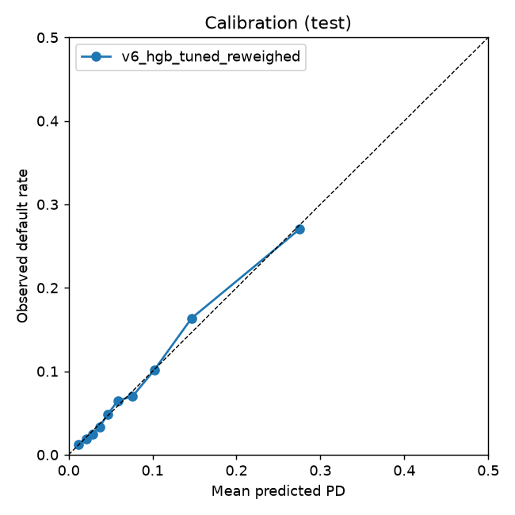
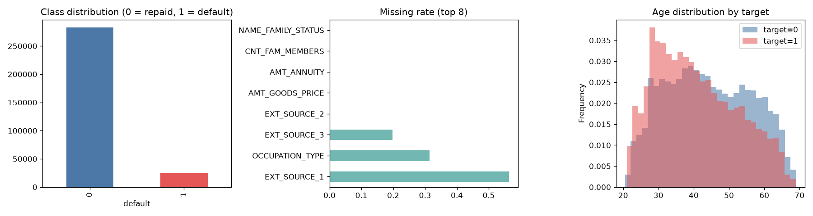
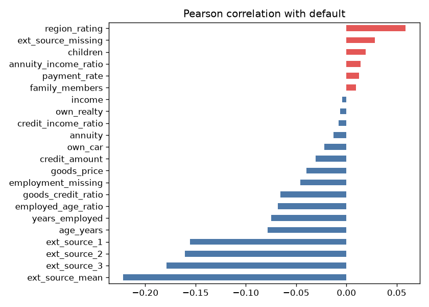
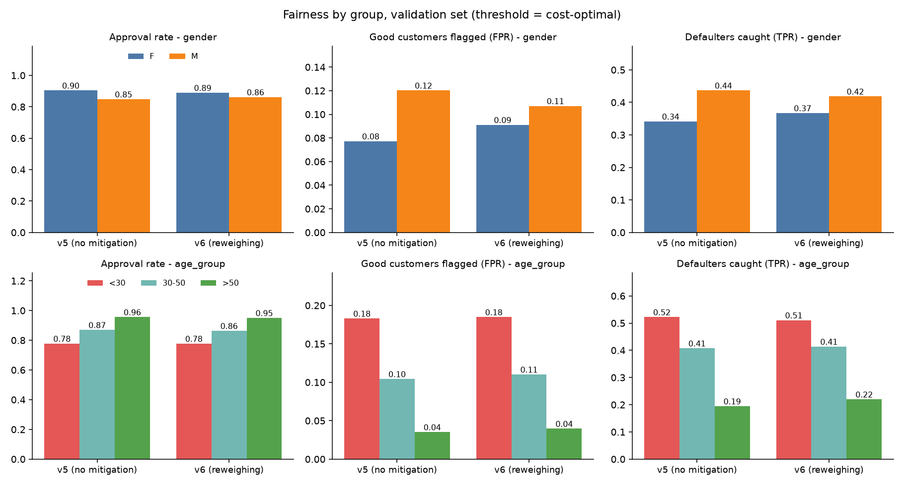
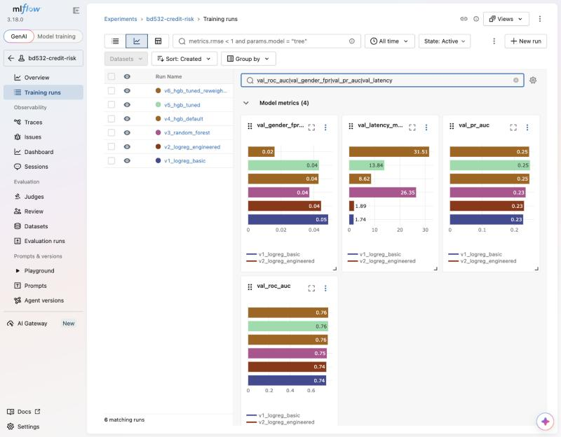
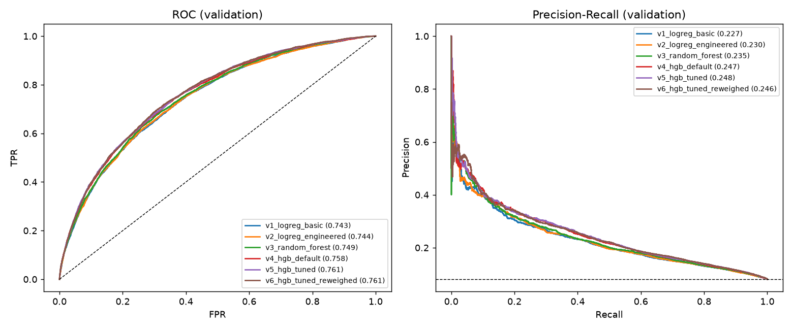
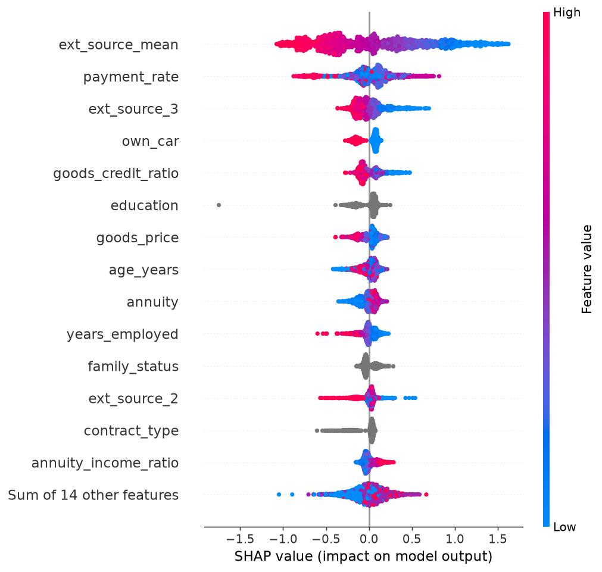
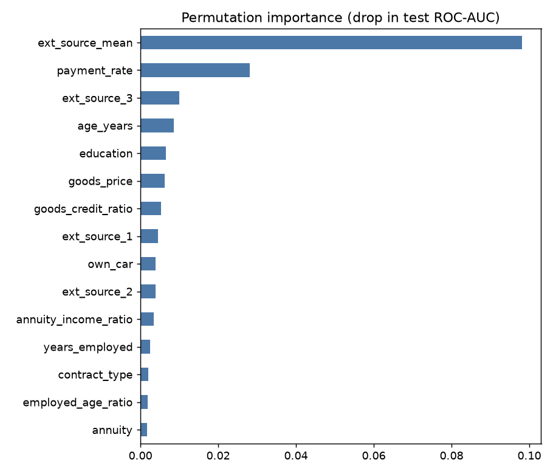
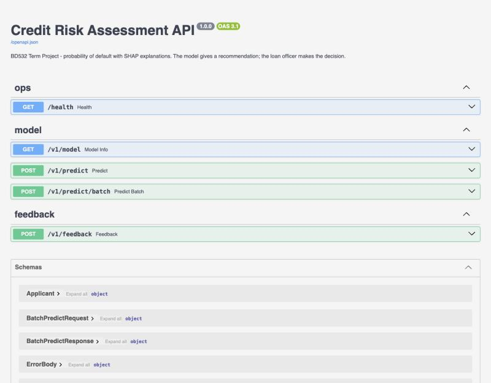

# Section 3 — ML Model Implementation

> ตัวเลขในเอกสารนี้มาจากการรันบน **Home Credit `application_train.csv` จริง (307,511 แถว, default 8.07%)**
> ผลฉบับเต็มสร้างอัตโนมัติใน `reports/results.md` / `reports/results.json` และ EDA อยู่ใน `reports/eda/eda_summary.md`

## สรุปผลลัพธ์

| | ค่า |
|---|---|
| Split | train 215,257 / validation 46,127 / test 46,127 (stratified) |
| โมเดลที่เลือก | **v6_hgb_tuned_reweighed** (HistGradientBoosting + reweighing) |
| Test ROC-AUC / PR-AUC / KS | **0.764** / 0.246 / 0.399 |
| 5-fold CV ROC-AUC (train) | 0.756 ± 0.005 (เสถียร) |
| Brier (test) | 0.068 · mean predicted PD ใกล้ actual ทุกกลุ่ม (calibrated) |
| Decision threshold (cost 5:1) | PD ≥ 16.4% → HIGH_RISK (12.1% ของคำขอ) และจับ defaulter ได้ 38% |

| Band (test) | สัดส่วนคำขอ | Default rate จริง |
|---|---|---|
| LOW_RISK | 67.7% | **3.7%** |
| REVIEW | 20.1% | 12.3% |
| HIGH_RISK | 12.1% | **25.3%** |

→ band แยกความเสี่ยงได้ชัด กลุ่ม HIGH_RISK มีอัตราผิดนัด **6.8 เท่า** ของกลุ่ม LOW_RISK เจ้าหน้าที่จึงโฟกัสได้ที่ ~32% ของคำขอ (REVIEW+HIGH)

## 3.1 Model Training Implementation

| ขั้นตอน | ไฟล์ | สาระสำคัญ |
|---|---|---|
| Data exploration | `src/credit_risk/eda.py` → `reports/eda/` | dtype, missing %, describe, class distribution, default rate รายหมวด, correlation, กราฟ |
| Preprocessing | `src/credit_risk/features.py` | แปลง `DAYS_*` เป็นปี, แปลง sentinel 365243 → NaN + flag, Y/N → 0/1, ตรวจช่วงค่า, สร้าง 8 domain ratios, แยก sensitive attributes ออก |
| Model architecture | `src/credit_risk/model.py` | `Pipeline(ColumnTransformer[median impute + missing indicator (+scale) / "Unknown" impute + one-hot (rare grouped)] → classifier)` |
| Training loop & hyper-parameters | `src/credit_risk/train.py`, `EXPERIMENTS` | 6 versions พร้อม hyper-parameters ที่ระบุชัด HistGB tuned ใช้ lr 0.05, ≤600 iterations, early stopping (n_iter_no_change 30), L2 1.0, min_samples_leaf 80 |
| Validation | `train.py` | Stratified split 70/15/15, เปรียบเทียบบน validation, เลือก threshold บน validation ด้วย cost 5:1, 5-fold stratified CV เพื่อดูความเสถียร, test set ใช้ครั้งเดียว |
| Results analysis | `reports/results.md`, `reports/figures/` | ROC/PR curves, calibration plot, decision band table, confusion counts |
| Unit tests (extra) | `tests/` (40 tests) | feature conversion, ratio math, inf/NaN safety, unseen category, SHAP additivity, reweighing math, metrics, API contract |

**ผล EDA ที่สำคัญ:**
* Default rate 8.07% → imbalance 11.4 : 1
* `DAYS_EMPLOYED = 365243` เป็นค่า sentinel 18.0% (ผู้เกษียณ/ไม่มีงาน) แก้เป็น NaN + flag
* Missing: `EXT_SOURCE_1` 56.4%, `OCCUPATION_TYPE` 31.3% → imputation + missing indicators
* `CODE_GENDER = 'XNA'` 4 แถว → unknown
* Default rate ผู้ชาย 10.1% เทียบกับผู้หญิง 7.0% และอายุ <30 ปี 11.4% เทียบกับ >50 ปี 5.7% (มี historical difference จริง)
* Feature ที่สัมพันธ์กับ default สูงสุด: `ext_source_mean` (r = −0.22), `ext_source_3` (−0.18), `ext_source_2` (−0.16), อายุ (−0.08)

**ทำไมใช้ metric เหล่านี้:** ข้อมูลไม่สมดุล accuracy จึงไม่มีความหมาย (ทาย “ไม่ผิดนัด” ทั้งหมดได้ 92%) จึงใช้ ROC-AUC (ranking), PR-AUC (คลาสส่วนน้อย), KS (มาตรฐาน credit scoring), Brier (calibration) และ expected cost (ผลทางธุรกิจ)

## 3.2 Model Fairness Analysis

* **แหล่ง bias ที่เป็นไปได้:** (1) historical bias: ผู้ชายผิดนัดสูงกว่า (10.1% เทียบกับ 7.0%) (2) proxy: อาชีพ, การมีรถ, รายได้ สัมพันธ์กับเพศ (3) selection bias: มี label เฉพาะคนที่เคยได้รับอนุมัติ (4) อายุ: ผู้กู้อายุน้อยมี default สูงจริง แต่เสี่ยงต่อ age discrimination
* **Metrics ที่คำนวณ** (`src/credit_risk/fairness.py`): approval rate, Demographic parity difference, **Disparate Impact ratio** (เกณฑ์ 4/5 = 0.8), Equal opportunity difference (TPR), FPR gap (ลูกค้าดีถูก flag), AUC ต่อกลุ่ม, mean PD เทียบ actual (calibration ต่อกลุ่ม) ทำทั้ง gender และ age group
* **Mitigation ที่ทำ:** (a) ไม่ใช้ gender เป็น feature (fairness through unawareness) (b) **Reweighing** (Kamiran & Calders) ใน v6 แล้วเปรียบเทียบผลกับ v5 (c) ใช้ FPR gap เป็นเกณฑ์ tie-break ตอนเลือกโมเดล (d) monitor รายเดือนใน production
* **ผล (validation):**

  | Version | ROC-AUC | Gender FPR gap | Gender DI |
  |---|---|---|---|
  | v5_hgb_tuned | 0.7607 | 0.043 | 0.938 |
  | v6_hgb_tuned_reweighed | 0.7612 | **0.016** | **0.969** |

  Reweighing ลดช่องว่าง FPR ระหว่างเพศลง **63%** โดย AUC ไม่ลดลง
  บน test: gender DI = 0.956, FPR gap = 0.028, AUC ต่อเพศ 0.761 เทียบกับ 0.763

  

* **สิ่งที่ยังเหลือ: อายุ** age-group DI = **0.829** (ผ่านเกณฑ์ 0.8 แบบเฉียด) กลุ่ม <30 ถูก flag มากกว่า (FPR 18% เทียบกับ 4% ของกลุ่ม >50)
  แต่ default rate จริงก็ต่างกัน (11.0% เทียบกับ 5.9%) และ PD เฉลี่ยตรงกับ actual ในทุกกลุ่ม (11.2% เทียบกับ 11.0%, 5.9% เทียบกับ 5.9%) ช่องว่างจึงสะท้อนความเสี่ยงจริงมากกว่า miscalibration
* **Proxy ที่พบจาก SHAP:** `own_car` มี importance อันดับ 4 และสัมพันธ์กับเพศ จึงเป็น proxy ที่ reweighing ช่วยลดผลได้
* **ข้อถกเถียง:** อายุเป็นปัจจัยความเสี่ยงที่ใช้กันทั่วไปในอุตสาหกรรม การตัด age ออกหรือใช้ group-aware threshold อาจขัดกับหลัก equal treatment จึงเป็นการตัดสินใจเชิงนโยบาย ทางที่ทำต่อได้คือทดลอง version ที่ไม่มี age แล้ววัด AUC ที่เสียไปเทียบกับ DI ที่ได้

## 3.3 Model Versioning and Experimentation (MLflow)

* Tracking URI: `sqlite:///mlflow.db`, experiment `bd532-credit-risk`
* ดู UI ด้วย `mlflow ui --backend-store-uri sqlite:///mlflow.db --port 5001` แล้วเปิด http://localhost:5001 (บน macOS พอร์ต 5000 ถูก AirPlay Receiver ใช้อยู่)
* ทุก run log: params, tags (model_type, engineered, reweigh, data), metrics validation (AUC, PR-AUC, KS, Brier, recall, precision, cost, fairness, latency, size, fit time), fairness CSV และ sklearn model พร้อม input example run ที่ถูกเลือกได้ tag `selected_model=true` พร้อม test metrics และ CV

| Version | สิ่งที่เปลี่ยน |
|---|---|
| v1_logreg_basic | baseline ใช้ฟิลด์ดิบ |
| v2_logreg_engineered | **preprocessing** + domain ratios |
| v3_random_forest | **architecture** bagging ใช้ class_weight |
| v4_hgb_default | **architecture** boosting ค่า default |
| v5_hgb_tuned | **hyper-parameters** lr↓ + regularisation + early stopping |
| v6_hgb_tuned_reweighed | **fairness mitigation** reweighing |

**ผลการเปรียบเทียบบน validation:**

| Version | ROC-AUC | PR-AUC | KS | Brier | Exp. cost | Gender FPR gap | Latency | Size |
|---|---|---|---|---|---|---|---|---|
| v1_logreg_basic | 0.7426 | 0.2273 | 0.354 | 0.0687 | 0.3483 | 0.049 | 1.7 ms | 0.01 MB |
| v2_logreg_engineered | 0.7437 | 0.2300 | 0.357 | 0.0686 | 0.3458 | 0.044 | 1.9 ms | 0.01 MB |
| v3_random_forest | 0.7490 | 0.2348 | 0.369 | **0.1832** ❌ | 0.3439 | 0.037 | 26.4 ms | 37.3 MB |
| v4_hgb_default | 0.7579 | 0.2466 | 0.381 | 0.0677 | 0.3362 | 0.043 | 8.6 ms | 0.38 MB |
| v5_hgb_tuned | 0.7607 | **0.2484** | 0.383 | 0.0676 | **0.3337** | 0.043 | 13.8 ms | 0.62 MB |
| **v6_hgb_tuned_reweighed** ✅ | **0.7612** | 0.2458 | **0.389** | 0.0677 | 0.3353 | **0.016** | 31.5 ms | 1.47 MB |

**กฎการเลือกโมเดล (อัตโนมัติและบันทึกไว้ใน `results.md`):**
1. *Calibration gate*: Brier ≤ 1.10 × Brier ที่ดีที่สุด (เพราะ UI แสดง PD เป็น %) → ตัด v3
2. ROC-AUC สูงสุด โดยโมเดลที่ต่างกันไม่เกิน 0.003 ถือว่าเท่ากัน → v5, v6
3. Tie-break ด้วย gender FPR gap ต่ำสุด แล้วจึงดู latency → **v6**

**การวิเคราะห์:**
* **Preprocessing (v1→v2):** domain ratios เพิ่ม AUC เพียง +0.001 เพราะโมเดลเชิงเส้นใช้ ratio ได้จำกัด แต่ boosting ใช้ `payment_rate` เป็น feature อันดับ 2
* **Architecture (v2→v4):** boosting ดีกว่า linear อย่างชัดเจน (+0.014 AUC) แสดงว่าความสัมพันธ์ไม่เป็นเชิงเส้น
* **Hyper-parameters (v4→v5):** learning rate ต่ำลง + regularisation + early stopping เพิ่มอีก +0.003 และได้ expected cost ต่ำที่สุด
* **Random Forest** ตกเกณฑ์ calibration (`class_weight` ทำให้ PD สูงเกินจริง Brier แย่กว่า 2.7 เท่า) และใหญ่ช้ากว่ามาก
* **v5 กับ v6 ต่างกันไม่เกิน 0.003 AUC** จึงตัดสินด้วยความเป็นธรรม v6 ลด gender FPR gap 63% ส่วน trade-off คือ latency สูงขึ้น (31 ms) และ expected cost สูงขึ้นเล็กน้อย (+0.0016) แต่ยังต่ำกว่าเป้า 300 ms มาก

## 3.4 Model Explainability

* **SHAP** (`src/credit_risk/explain.py`) ใช้ TreeExplainer สำหรับ RF/HistGB และ LinearExplainer สำหรับ LogReg รวม SHAP ของคอลัมน์ one-hot กลับเป็นฟิลด์เดิม
* Global: `reports/figures/shap_bar.png` (mean |SHAP|), `shap_beeswarm.png` (ทิศทางและค่า)
* Cross-check: **Permutation importance** (ROC-AUC ที่ลดลงบน test) → `permutation_importance.png`

* **Top features (mean |SHAP| บน test):** 1) `ext_source_mean` 0.51 2) `payment_rate` 0.18 3) `ext_source_3` 0.11 4) `own_car` 0.10 5) `goods_credit_ratio` 0.09 6) education 7) goods_price 8) age
  ผล permutation importance สอดคล้องกัน: `ext_source_mean` ทำให้ AUC ลดลงมากที่สุด (0.098) ตามด้วย `payment_rate` (0.028)
* **การตีความเชิงธุรกิจ (5C’s of credit):**
  * *Character* (ประวัติเครดิต): คะแนน bureau เป็นสัญญาณแรงที่สุด ห่างตัวอื่นมาก
  * *Capacity* (ความสามารถชำระ): `annuity_income_ratio` (DSTI) สูงเพิ่มความเสี่ยงอย่างสม่ำเสมอ ส่วน `payment_rate` (ค่างวด/วงเงิน ≈ 1/จำนวนงวด) สำคัญเป็นอันดับ 2 แต่ความสัมพันธ์**ไม่เป็นทางเดียว (non-monotonic)**: beeswarm มีค่าสูง (สีแดง) อยู่ทั้งฝั่งเพิ่มและลดความเสี่ยง แสดงว่าผลขึ้นกับระยะสัญญาร่วมกับปัจจัยอื่น โมเดลเชิงเส้นจับแบบนี้ไม่ได้ ซึ่งอธิบายว่าทำไม boosting ชนะ
  * *Collateral*: `goods_credit_ratio` ต่ำ (กู้มากกว่ามูลค่าสินค้า) เพิ่มความเสี่ยง คล้าย LTV สูง
  * *Stability*: อายุและอายุงานมากขึ้นลดความเสี่ยง
* ⚠️ `own_car` สำคัญกว่าที่คาด และอาจเป็น proxy ของเพศ (ดู 3.2)

## 3.5 Prediction Reasoning

`CreditExplainer.explain_applicant()` คืน top-k เหตุผลที่มี label ภาษาไทย/อังกฤษ ค่าจริงที่จัดรูปแบบแล้ว ค่า SHAP และทิศทาง
`train.py` เลือก 3 เคสจาก test set อัตโนมัติ (ความเสี่ยงต่ำ ก้ำกึ่ง สูง) แล้วบันทึกไว้ใน `reports/results.md` ส่วน *Example explanations*
มี unit test ตรวจว่า `base + ΣSHAP` = logit ของ prediction (additivity) จึงเชื่อได้ว่าเหตุผลสอดคล้องกับตัวเลขจริง

**ตัวอย่างจาก test set:**

| Case | PD / Score / Band | เหตุผลหลัก (SHAP, log-odds) | ผลจริง |
|---|---|---|---|
| ความเสี่ยงต่ำ | 1.2% / 627 / LOW_RISK | ▼ คะแนนเครดิตเฉลี่ย 0.70 (−0.78) · ▼ payment rate 0.098 (−0.71) · ▲ โสด (+0.13) · ▼ อายุ 61 (−0.12) | ชำระปกติ |
| ก้ำกึ่ง | 16.4% / 468 / HIGH_RISK | ▲ คะแนนเครดิตเฉลี่ย 0.34 (+0.80) · ▲ payment rate 0.051 (+0.23) · ▲ score 1 = 0.14 (+0.18) · ▼ ปริญญาตรี (−0.17) | ชำระปกติ |
| ความเสี่ยงสูง | 33.6% / 414 / HIGH_RISK | ▲ คะแนนเครดิตเฉลี่ย 0.26 (+0.80) · ▲ ราคาสินค้า/วงเงิน 0.70 (+0.34) · ▲ payment rate 0.047 (+0.24) · ▼ อายุ 24 (−0.14) | ชำระปกติ |

ข้อสังเกต: เคส “เสี่ยงสูง” ชำระปกติจริง ซึ่งแสดงว่า PD 34% ยังหมายถึงโอกาสชำระได้ 66% นี่คือเหตุผลที่ระบบ **ไม่ปฏิเสธอัตโนมัติ** แต่ส่งให้เจ้าหน้าที่พิจารณา
ส่วน “อายุ 24 ลดความเสี่ยง” ในเคสสุดท้ายเป็น interaction effect ของ tree model (เทียบกับคนที่มีโปรไฟล์อื่นเหมือนกัน) ที่ควรอธิบายอย่างระมัดระวัง

## 3.6 Model Deployment as a Service

* FastAPI (`api/main.py`) พร้อม OpenAPI docs อัตโนมัติที่ `/docs` และสัญญา payload ใน `api/schemas.py`
* Endpoints: `GET /health`, `GET /v1/model`, `POST /v1/predict`, `POST /v1/predict/batch` (≤100), `POST /v1/feedback`
* Validation: `tests/test_api.py` (TestClient) + `scripts/run_interface_tests.py` (live server, 17/17 ผ่าน) + Postman collection

* **Scalability:**
  * Stateless: โหลดโมเดลครั้งเดียวตอน startup จึงเพิ่ม worker/replica ได้ (`uvicorn --workers 4`, Docker + Kubernetes HPA)
  * โมเดลเล็ก (1.5 MB) และ CPU-only latency ~40 ms ต่อ request รวม SHAP
  * Batch endpoint สำหรับ re-score พอร์ต และมีการจำกัดขนาด (413) เพื่อป้องกัน overload
  * ถ้าต้องการเร็วขึ้น: คำนวณ SHAP แบบ on-demand (`explain=false` สำหรับ batch) หรือใช้ v5 ที่เร็วกว่า 2 เท่า
  * Production: เปลี่ยน JSONL log เป็น message queue/DB, ใส่ API gateway (auth, rate limit), ใช้ MLflow Model Registry สำหรับ promote/rollback และใช้ canary deploy เวอร์ชันใหม่
