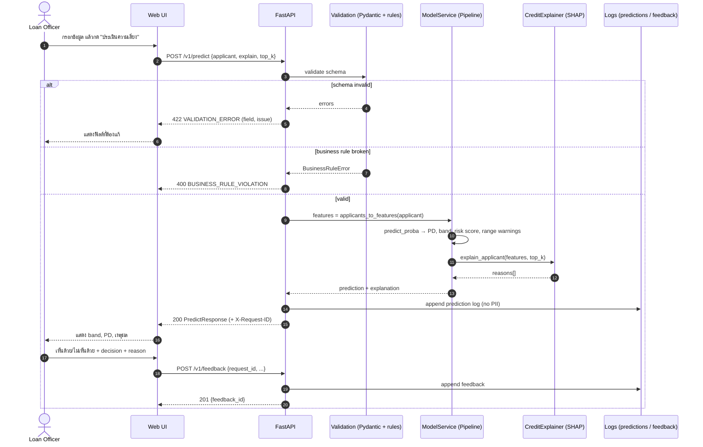
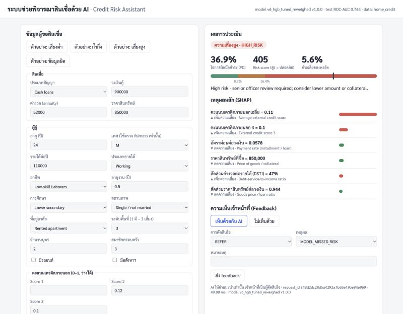
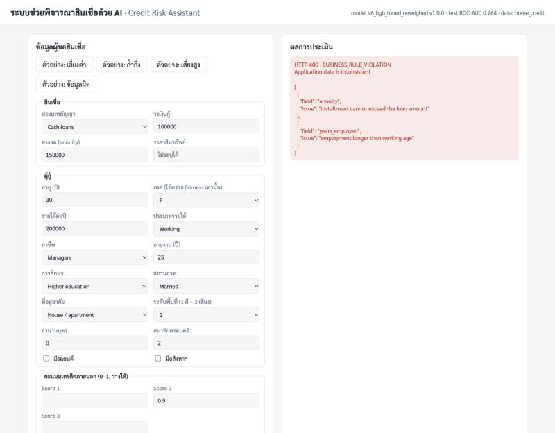

# Section 4 — UI-Model Interface

## 4.1 UI-Model Interface Design

Base URL `http://localhost:8000` · Content-Type `application/json` · schema ฉบับเต็ม: `/docs` หรือ `/openapi.json` (สร้างจาก `api/schemas.py`)

### Request payload — `POST /v1/predict`

```json
{
  "application_id": "APP-2026-000123",      // optional, ≤ 64 chars
  "explain": true,                          // optional, default true
  "top_k": 5,                               // optional, 1–10
  "applicant": {
    "contract_type": "Cash loans",          // enum: Cash loans | Revolving loans
    "gender": "F",                          // optional M|F — fairness monitoring ONLY, not a model input
    "own_car": false,                       // bool
    "own_realty": true,                     // bool
    "children": 1,                          // int 0–20
    "income": 180000,                       // > 0, annual
    "credit_amount": 500000,                // > 0
    "annuity": 25000,                       // > 0, must be ≤ credit_amount (400 otherwise)
    "goods_price": 450000,                  // optional > 0
    "income_type": "Working",               // enum (8 values)
    "education": "Higher education",        // enum (5 values)
    "family_status": "Married",             // enum (6 values)
    "housing_type": "House / apartment",    // enum (6 values)
    "age_years": 38,                        // 18–100
    "years_employed": 6.5,                  // optional 0–60, null = not employed / pensioner
    "occupation": "Core staff",             // optional enum (18 values)
    "family_members": 3,                    // int 1–20, must be ≥ children + 1
    "region_rating": 2,                     // 1–3
    "ext_source_1": null,                   // optional 0–1 (credit bureau)
    "ext_source_2": 0.62,
    "ext_source_3": 0.55
  }
}
```
ฟิลด์ที่ไม่รู้จักจะถูกปฏิเสธ (`extra="forbid"`) เพื่อจับการพิมพ์ชื่อฟิลด์ผิดตั้งแต่ต้น

### Response payload — `200 OK`

```json
{
  "request_id": "5f0c…",                    // also in X-Request-ID header
  "application_id": "APP-2026-000123",
  "model": {"name": "v6_hgb_tuned_reweighed", "version": "1.0.0",
            "trained_at": "2026-11-21T13:20:00+00:00", "data_source": "home_credit"},
  "prediction": {
    "probability_of_default": 0.0731,       // calibrated PD
    "risk_score": 556,                      // 0–1000, higher = safer (PDO 40, 600 @ 50:1)
    "decision_band": "REVIEW",              // LOW_RISK | REVIEW | HIGH_RISK
    "recommendation": "Moderate risk - verify income/obligations before deciding.",
    "thresholds": {"review": 0.093, "high_risk": 0.186}
  },
  "explanation": {
    "base_probability": 0.051,              // portfolio average
    "reasons": [
      {"feature": "ext_source_mean", "label": "Average external credit score",
       "label_th": "คะแนนเครดิตภายนอกเฉลี่ย", "value": "0.585", "shap_value": -0.41,
       "direction": "decreases_risk",
       "text": "Average external credit score = 0.585 decreases default risk"}
    ]
  },
  "warnings": [],                           // e.g. inputs outside training range
  "latency_ms": 9.8,
  "timestamp": "2026-11-21T13:35:02+00:00"
}
```

Feedback: `POST /v1/feedback` `{request_id, application_id?, officer_decision: APPROVE|DECLINE|REFER, agrees_with_model, reason_code?, comment?, actual_outcome?}` → `201 {feedback_id, stored, timestamp}`

### Error handling

ทุก error ใช้รูปแบบเดียวกัน:
```json
{"error": {"code": "VALIDATION_ERROR", "message": "Request payload failed validation",
           "details": [{"field": "applicant.income", "issue": "Field required", "type": "missing"}]},
 "request_id": "5f0c…"}
```

| HTTP | `error.code` | เมื่อไร | UI ทำอะไร |
|---|---|---|---|
| 400 | `MALFORMED_JSON` | body ไม่ใช่ JSON ที่ถูกต้อง | แสดงข้อความ ไม่ควรเกิดจาก UI |
| 400 | `BUSINESS_RULE_VIOLATION` | ข้อมูลขัดแย้งกัน (ค่างวด > วงเงิน, อายุงาน > อายุ−14, ครอบครัว < บุตร+1) | ชี้ฟิลด์ใน `details` ให้แก้ |
| 404 | `NOT_FOUND` | path ไม่มี | — |
| 405 | `METHOD_NOT_ALLOWED` | method ผิด | — |
| 413 | `BATCH_TOO_LARGE` | batch > 100 | แบ่ง batch |
| 422 | `VALIDATION_ERROR` | ขาดฟิลด์, ผิด type, enum ผิด, ค่านอกช่วง, ฟิลด์เกิน | แสดงรายการ field/issue |
| 500 | `INTERNAL_ERROR` | exception ที่ไม่คาดคิด (log stack trace ฝั่ง server) | แจ้งลองใหม่ ใช้ `request_id` ติดตาม |
| 503 | `MODEL_UNAVAILABLE` | โหลดโมเดลไม่ได้ (`/health` → `degraded`) | แจ้งให้ใช้กระบวนการ manual |

### Sequence diagram



## 4.2 Interface Testing and Implementation

ใช้ 3 ช่องทาง:
1. **Postman collection** `postman/credit_risk_api.postman_collection.json` มี 17 requests ใน 4 folders พร้อม test script (status, error code, band, latency < 500 ms, fairness check) import เข้า Postman แล้วรัน *Run collection*
2. **Live runner** `python scripts/run_interface_tests.py` รัน scenario ชุดเดียวกันกับ server จริงและเขียนผลลง `reports/interface_test_results.md` (ล่าสุด **17/17 PASS**)
3. **Web UI** ที่ `http://localhost:8000/` มีปุ่มตัวอย่างความเสี่ยงต่ำ/ก้ำกึ่ง/สูง และข้อมูลผิด รวมถึงส่ง feedback ได้ และ `pytest tests/test_api.py` อีก 22 tests

### Test scenarios

| # | Scenario | Expected | Result |
|---|---|---|---|
| S1 | ผู้กู้ความเสี่ยงต่ำ (ข้าราชการ อายุงาน 15 ปี คะแนน bureau 0.75–0.80) | 200, LOW_RISK | ✅ PD 1.3% |
| S2 | ผู้กู้ทั่วไป | 200, มีเหตุผล | ✅ |
| S3 | ผู้กู้ความเสี่ยงสูง (อายุ 24 อายุงาน 0.5 ปี DSTI 47% คะแนน 0.1) | 200, HIGH_RISK | ✅ PD 36.9% |
| S4 | S2 แต่เปลี่ยนเพศเป็น M | PD เท่ากับ S2 | ✅ (ยืนยัน SPEC-4) |
| S5 | Batch 3 รายการ | 200, count 3 | ✅ |
| E1–E8 | ขาดฟิลด์, enum ผิด, ค่านอกช่วง, JSON เสีย, ข้อมูลขัดแย้ง, batch 101, path ผิด, method ผิด | 422/422/422/400/400/413/404/405 | ✅ ทั้งหมด |
| F1–F2 | Feedback ถูกต้อง / ไม่ถูกต้อง | 201 / 422 | ✅ |





### Challenges encountered & solutions

| ปัญหาที่เจอจริง | วิธีแก้ |
|---|---|
| FastAPI ตอบ JSON ที่เสียเป็น 422 เหมือน validation error ทำให้ UI แยกสาเหตุไม่ได้ | custom `RequestValidationError` handler แยก `json_invalid` → 400 `MALFORMED_JSON` และทำ error envelope ให้เหมือนกันทุก status |
| ข้อมูลผ่าน schema แต่ไม่สมเหตุสมผล (ค่างวด > วงเงิน) โมเดลยังให้ผลที่ดูน่าเชื่อ | เพิ่ม business-rule layer → 400 พร้อมรายการฟิลด์ |
| โมเดลที่ใช้ class weighting ให้ PD เฉลี่ย ~41% (จริง ~9%) ทำให้ UI แสดงตัวเลขผิด | เพิ่ม calibration gate (Brier) ในการเลือกโมเดล และใช้ cost-based threshold แทนการปรับน้ำหนัก |
| SHAP ของ one-hot แยกเป็นหลายคอลัมน์ (เช่น `education_Higher education`) อ่านยาก | `transformed_feature_map()` รวม SHAP กลับเป็นฟิลด์เดิม + label ภาษาไทย |
| Training-serving skew: UI ส่งหน่วย “ปี” แต่ข้อมูล train ใช้ “วันติดลบ” | แยก `raw_to_applicants()` (train) ออกจาก `applicants_to_features()` (ใช้ร่วมกัน) และเก็บ preprocessing ไว้ใน sklearn Pipeline |
| MLflow 3 ใช้ skops serialization ซึ่งปฏิเสธ sklearn tree types | ระบุ `skops_trusted_types` เฉพาะ type ของโมเดลที่เราสร้างเอง |
| ต้องการเก็บเพศไว้ตรวจ fairness แต่ห้ามใช้ทำนาย | รับ `gender` ใน request แต่ `applicants_to_features()` ตัดทิ้ง เก็บไว้ใน prediction log เท่านั้น และทดสอบด้วย S4 |
| JSON ไม่รองรับ NaN ตอนคืน metrics ใน `/v1/model` | แปลง NaN → `null` ก่อนตอบ |
