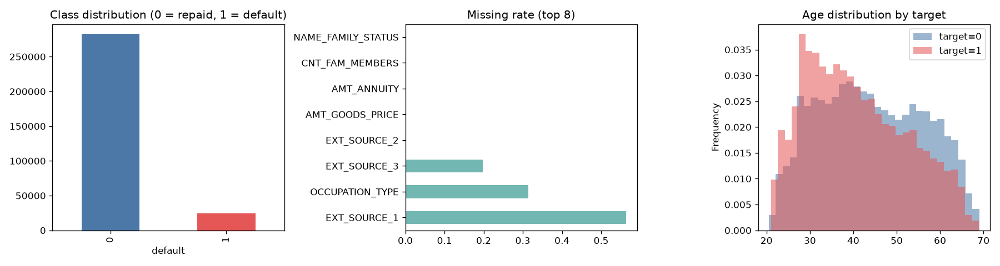
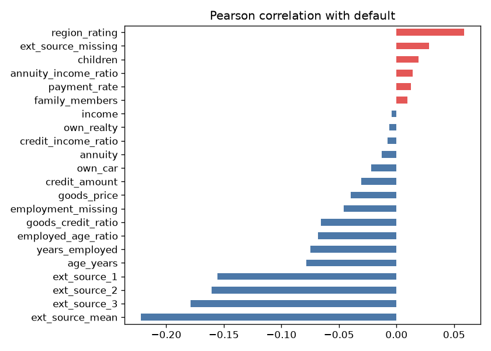

# Exploratory Data Analysis

* Source: Home Credit application_train.csv
* Rows: 307,511  |  raw columns used: 23  |  model features: 28
* Default rate (TARGET=1): **8.07%**  ->  class imbalance 11.4 : 1

## 1. Data types

| column | dtype | missing % | unique |
|---|---|---|---|
| SK_ID_CURR | int64 | 0.0% | 307,511 |
| TARGET | int64 | 0.0% | 2 |
| NAME_CONTRACT_TYPE | str | 0.0% | 2 |
| CODE_GENDER | str | 0.0% | 3 |
| FLAG_OWN_CAR | str | 0.0% | 2 |
| FLAG_OWN_REALTY | str | 0.0% | 2 |
| CNT_CHILDREN | int64 | 0.0% | 15 |
| AMT_INCOME_TOTAL | float64 | 0.0% | 2,548 |
| AMT_CREDIT | float64 | 0.0% | 5,603 |
| AMT_ANNUITY | float64 | 0.0% | 13,672 |
| AMT_GOODS_PRICE | float64 | 0.1% | 1,002 |
| NAME_INCOME_TYPE | str | 0.0% | 8 |
| NAME_EDUCATION_TYPE | str | 0.0% | 5 |
| NAME_FAMILY_STATUS | str | 0.0% | 6 |
| NAME_HOUSING_TYPE | str | 0.0% | 6 |
| DAYS_BIRTH | int64 | 0.0% | 17,460 |
| DAYS_EMPLOYED | int64 | 0.0% | 12,574 |
| OCCUPATION_TYPE | str | 31.3% | 18 |
| CNT_FAM_MEMBERS | float64 | 0.0% | 17 |
| REGION_RATING_CLIENT | int64 | 0.0% | 3 |
| EXT_SOURCE_1 | float64 | 56.4% | 114,584 |
| EXT_SOURCE_2 | float64 | 0.2% | 119,831 |
| EXT_SOURCE_3 | float64 | 19.8% | 814 |

## 2. Numeric statistics (after unit conversion)

|                      |   count |       mean |        std |       min |        25% |        50% |        75% |           max |
|:---------------------|--------:|-----------:|-----------:|----------:|-----------:|-----------:|-----------:|--------------:|
| own_car              |  307511 |      0.34  |      0.474 |     0     |      0     |      0     |      1     |      1        |
| own_realty           |  307511 |      0.694 |      0.461 |     0     |      0     |      1     |      1     |      1        |
| children             |  307511 |      0.417 |      0.722 |     0     |      0     |      0     |      1     |     19        |
| income               |  307511 | 168798     | 237123     | 25650     | 112500     | 147150     | 202500     |      1.17e+08 |
| credit_amount        |  307511 | 599026     | 402491     | 45000     | 270000     | 513531     | 808650     |      4.05e+06 |
| annuity              |  307499 |  27108.6   |  14493.7   |  1615.5   |  16524     |  24903     |  34596     | 258026        |
| goods_price          |  307233 | 538396     | 369446     | 40500     | 238500     | 450000     | 679500     |      4.05e+06 |
| age_years            |  307511 |     43.907 |     11.948 |    20.504 |     33.985 |     43.121 |     53.886 |     69.073    |
| years_employed       |  252137 |      6.527 |      6.402 |    -0     |      2.1   |      4.512 |      8.693 |     49.04     |
| family_members       |  307509 |      2.153 |      0.911 |     1     |      2     |      2     |      3     |     20        |
| region_rating        |  307511 |      2.052 |      0.509 |     1     |      2     |      2     |      2     |      3        |
| ext_source_1         |  134133 |      0.502 |      0.211 |     0.015 |      0.334 |      0.506 |      0.675 |      0.963    |
| ext_source_2         |  306851 |      0.514 |      0.191 |     0     |      0.392 |      0.566 |      0.664 |      0.855    |
| ext_source_3         |  246546 |      0.511 |      0.195 |     0.001 |      0.371 |      0.535 |      0.669 |      0.896    |
| credit_income_ratio  |  307511 |      3.958 |      2.69  |     0.005 |      2.019 |      3.265 |      5.16  |     84.737    |
| annuity_income_ratio |  307499 |      0.181 |      0.095 |     0     |      0.115 |      0.163 |      0.229 |      1.876    |
| payment_rate         |  307499 |      0.054 |      0.022 |     0.022 |      0.037 |      0.05  |      0.064 |      0.124    |
| goods_credit_ratio   |  307233 |      0.901 |      0.097 |     0.167 |      0.835 |      0.894 |      1     |      6.667    |
| employed_age_ratio   |  252137 |      0.157 |      0.134 |    -0     |      0.056 |      0.119 |      0.219 |      0.729    |
| employment_missing   |  307511 |      0.18  |      0.384 |     0     |      0     |      0     |      0     |      1        |
| ext_source_mean      |  307339 |      0.509 |      0.15  |     0     |      0.414 |      0.525 |      0.623 |      0.879    |
| ext_source_missing   |  307511 |      0.764 |      0.65  |     0     |      0     |      1     |      1     |      3        |

## 3. Data-quality findings

* `DAYS_EMPLOYED == 365243` sentinel (pensioners/unemployed): 18.0% of rows -> set to NaN + flag `employment_missing`.
* `EXT_SOURCE_1` missing 56.4%, `OCCUPATION_TYPE` missing 31.3% -> imputation + missing indicators.
* `CODE_GENDER` values: {'F': 202448, 'M': 105059, 'XNA': 4} ('XNA' -> unknown).

## 4. Default rate by category

### education

| education                     |   count |   default_rate |
|:------------------------------|--------:|---------------:|
| Academic degree               |     164 |         0.0183 |
| Higher education              |   74863 |         0.0536 |
| Incomplete higher             |   10277 |         0.0848 |
| Secondary / secondary special |  218391 |         0.0894 |
| Lower secondary               |    3816 |         0.1093 |

### income_type

| income_type          |   count |   default_rate |
|:---------------------|--------:|---------------:|
| Businessman          |      10 |         0      |
| Student              |      18 |         0      |
| Pensioner            |   55362 |         0.0539 |
| State servant        |   21703 |         0.0575 |
| Commercial associate |   71617 |         0.0748 |
| Working              |  158774 |         0.0959 |
| Unemployed           |      22 |         0.3636 |
| Maternity leave      |       5 |         0.4    |

### contract_type

| contract_type   |   count |   default_rate |
|:----------------|--------:|---------------:|
| Revolving loans |   29279 |         0.0548 |
| Cash loans      |  278232 |         0.0835 |

### housing_type

| housing_type        |   count |   default_rate |
|:--------------------|--------:|---------------:|
| Office apartment    |    2617 |         0.0657 |
| House / apartment   |  272868 |         0.078  |
| Co-op apartment     |    1122 |         0.0793 |
| Municipal apartment |   11183 |         0.0854 |
| With parents        |   14840 |         0.117  |
| Rented apartment    |    4881 |         0.1231 |

### gender (sensitive - audit only)

| gender   |   count |   default_rate |
|:---------|--------:|---------------:|
| F        |  202448 |         0.07   |
| M        |  105059 |         0.1014 |

### age_group (sensitive - audit only)

| age_group   |   count |   default_rate |
|:------------|--------:|---------------:|
| 30-50       |  158930 |         0.0865 |
| <30         |   45186 |         0.1144 |
| >50         |  103395 |         0.0571 |

## 5. Correlation of numeric features with default

|                      |   pearson_r |
|:---------------------|------------:|
| ext_source_mean      |     -0.2221 |
| ext_source_3         |     -0.1789 |
| ext_source_2         |     -0.1605 |
| ext_source_1         |     -0.1553 |
| age_years            |     -0.0782 |
| years_employed       |     -0.075  |
| employed_age_ratio   |     -0.068  |
| goods_credit_ratio   |     -0.0654 |
| employment_missing   |     -0.046  |
| goods_price          |     -0.0396 |
| credit_amount        |     -0.0304 |
| own_car              |     -0.0219 |
| annuity              |     -0.0128 |
| credit_income_ratio  |     -0.0077 |
| own_realty           |     -0.0061 |
| income               |     -0.004  |
| family_members       |      0.0093 |
| payment_rate         |      0.0127 |
| annuity_income_ratio |      0.0143 |
| children             |      0.0192 |
| ext_source_missing   |      0.0281 |
| region_rating        |      0.0589 |

